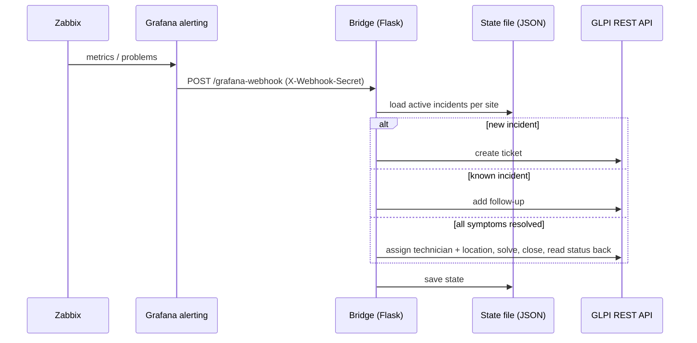

# Grafana → GLPI Alerting Bridge

[](https://github.com/bisquilha/grafana-glpi-alerting/actions/workflows/tests.yml)

A small Flask webhook that turns **Grafana alerts into GLPI service-desk tickets** and manages them like a person would: one ticket per incident, follow-ups for new symptoms, automatic solve/close on recovery, reopening if the problem comes back, and correlation so a single outage does not flood the service desk with tickets.

Built and running in production for a multi-site company (headquarters + branches connected by SD-WAN/IPsec, monitored by Zabbix and Grafana). This is a generic, sanitised version: no company names, hosts, IPs or credentials.

---

## Why

Grafana can send e-mails or chat messages, but an IT team that works from a service desk needs **tickets with a lifecycle**. Pointing Grafana straight at a ticket API creates one ticket per alert and per flap. This bridge adds the missing logic:

| Situation | What the bridge does |
|---|---|
| First symptom at a site | Opens a GLPI incident (category, group, requester and location filled in) |
| More symptoms at the same site | Adds **follow-ups** to the same ticket |
| Every symptom recovered | Adds a **solution** and **closes** the ticket |
| Problem returns within 60 min | **Reopens** the same ticket instead of opening a new one |
| Many sites fail at once (flood) | One **emergency ticket** for the event, not one per site |
| Tunnels from several branches drop together | Treated as an **HQ link** problem: follow-ups on the HQ ticket (hub-and-spoke correlation) |
| Backup / infrastructure alerts (`site=BACKUP`, `site=INFRA`) | Own category and title, never counted as network flood |

## Things GLPI enforces (learned in production)

Each of these broke the first live tests and is now handled and covered by tests:

- A ticket can only be solved/closed with a **technician user** assigned (a group is not enough): the bridge assigns its service account if nobody took the ticket.
- A ticket can only be solved/closed with a **location**: missing locations are filled from the site map or a default.
- GLPI sometimes answers **HTTP 200 but ignores the change** (or returns `false` inside the body): the bridge reads the status back and treats a mismatch as an error.
- If adding the solution is refused, it falls back to changing the status directly. A failure to close never breaks alert processing; it is logged so a person can close it manually.

## How it works



The site of an alert comes from the `site` label, then from the `[SITE]` token inside the Zabbix item name, then from the `host` label (with an optional host → site map).

## Configuration

Everything comes from environment variables:

| Variable | Meaning |
|---|---|
| `GLPI_URL` | e.g. `https://glpi.example.com/apirest.php` |
| `GLPI_APP_TOKEN`, `GLPI_USER_TOKEN` | GLPI API client token and the service account's user token |
| `GLPI_ENTITY_ID`, `GLPI_CATEGORY_ID`, `GLPI_GROUP_ID`, `GLPI_REQUESTER_ID` | Where tickets are created and who they are assigned to |
| `WEBHOOK_SECRET` | Shared secret sent by Grafana in the `X-Webhook-Secret` header |
| `SITES_FILE` | JSON map `site → GLPI location id` (see `config/sites.example.json`) |
| `STATE_FILE`, `LOG_FILE` | Optional paths (log goes to stderr/journald when unset) |

Tuning knobs (flood threshold, reopen window, tunnel alert names, categories per site) are constants at the top of `src/grafana_glpi_webhook.py`.

## Running

```bash
pip install -r requirements.txt
cp config/sites.example.json /etc/grafana_glpi/sites.json
# run behind gunicorn + systemd, see deploy/grafana-glpi-webhook.service
```

In Grafana, create a **webhook contact point** pointing to `https://<host>/grafana-webhook` with the header `X-Webhook-Secret: <secret>`, and route the alert rules to it. `GET /healthz` returns `{"status": "up"}`.

## Tests

The tests run the real webhook against an in-memory fake GLPI and replay real incidents (an 18-alert tunnel batch, flapping links, refused solutions, GLPI ignoring status changes, sites without location, flood events):

```bash
pip install flask requests
python tests/test_ticket_lifecycle.py   src/grafana_glpi_webhook.py
python tests/test_tunnel_correlation.py src/grafana_glpi_webhook.py
python tests/test_backup_infra_alerts.py src/grafana_glpi_webhook.py
```

Ticket texts and log messages are in Portuguese (the language of the original service desk).

## Tech

Python 3 · Flask · GLPI REST API · Grafana Alerting (webhook contact point) · Zabbix · systemd

---

## Resumo em português

Webhook em Flask que transforma alertas do Grafana em chamados no GLPI com ciclo de vida completo:

- abre o chamado e registra novos sintomas como acompanhamento;
- soluciona e fecha sozinho quando tudo normaliza, e reabre se o problema voltar em até 60 minutos;
- consolida quedas em massa em um chamado de emergência;
- correlaciona quedas de túnel das filiais com o link da matriz.

Também resolve as exigências do GLPI para fechar chamados (técnico e localização obrigatórios) e confere se o status realmente mudou. Usado em produção numa empresa com várias unidades; esta é uma versão genérica, sem dados da empresa.

## License

[MIT](LICENSE)
